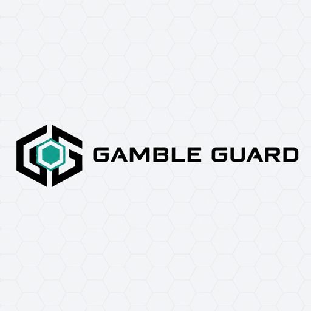
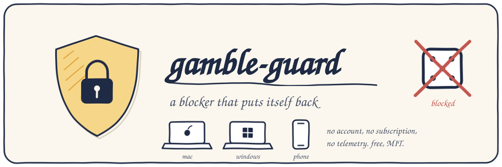
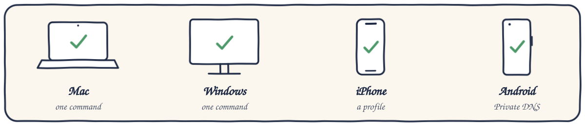
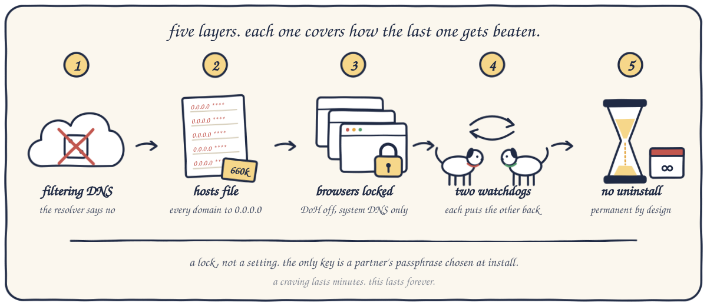

<p align="center"></p>
<p align="center"></p>
<p align="center">


</p>

# gamble-guard

A free, open-source gambling blocker with no uninstall. macOS, Windows, iPhone, Android.
No account, no subscription, no kernel extension, no telemetry.

Install it and every gambling site is blocked, system-wide — every browser, every app. It covers
**~670,000 domains worldwide**: North America, Latin America and the Caribbean, Europe including
Malta- and Curaçao-licensed offshore casinos and Eastern Europe, Australia; regulated and unregulated
alike. The list is rebuilt every week from every actively maintained public gambling blocklist, so new
casinos get blocked without you doing anything. VPN and proxy bypass routes are blocked too.

> **This is no joke. Once installed, this cannot be uninstalled.**
> The installer says so and makes you type `YES` before it touches anything. There is no uninstall
> command afterwards — only an accountability partner's passphrase set at install, or a finite
> `LOCK_DAYS` you chose up front.

## Install

<p align="center"></p>

**macOS** — needs your password:

1. In Terminal:

   ```sh
   curl -fsSL https://raw.githubusercontent.com/prime-server/gamble-guard/main/install.sh | sudo bash
   ```

2. Turn off iCloud Private Relay: System Settings → Apple Account → iCloud → Private Relay → **Off**.
   Safari then goes through the filter like every other app.

**Windows** — one command in an *Administrator* PowerShell:

```powershell
irm https://raw.githubusercontent.com/prime-server/gamble-guard/main/win/install.ps1 | iex
```

When it finishes, a page opens: <https://prime-server.github.io/gamble-guard/> — it checks live that
gambling sites no longer load on your device.

**iPhone / iPad** — open [`mobile/gamble-guard.mobileconfig`](mobile/gamble-guard.mobileconfig) on the
device and install it, then follow [`mobile/QUICKSTART.md`](mobile/QUICKSTART.md).

**iPhone app** (free; build it with your own Apple Developer account for now): [`ios/README.md`](ios/README.md).

**Android** — Settings → Network → Private DNS → `family.dns.mullvad.net`. Details in
[`mobile/README.md`](mobile/README.md).

Or open this folder in [Claude Code](https://claude.com/claude-code) and say *"install this"* — the repo
ships a `CLAUDE.md` that tells the agent how, and tells it never to help you undo it.

Verify (desktop): `bet365.com` should fail to load, and resolve to `0.0.0.0` or nothing.

### Make it stick

The default install is permanent: there is no uninstall command, and the two daemons put every layer
back if anything is removed. These options decide who, if anyone, can ever lift it:

| Option | What it does |
|---|---|
| `PARTNER=1 sudo ./install.sh` | an accountability partner types a passphrase you never see; that passphrase is the only thing that can remove the guard |
| `LOCK_DAYS=90 sudo ./install.sh` | an opt-in finite lock: the guard stays for that many days, then can be lifted |
| `sudo ./harden.sh <user> "Name"` | a partner-held admin account; you become a Standard user, so not even your own admin password can touch it |
| `VPN_BLOCK=0 sudo ./install.sh` | opts out of the VPN / proxy / DoH-bypass block (16k domains, on by default; Tailscale, Mullvad DNS and corporate VPNs are allowlisted) |

Flags combine: `LOCK_DAYS=90 PARTNER=1 sudo ./install.sh`. On Windows: `install.ps1 -LockDays 90 -Partner`,
and account hardening there is a Standard account with the partner holding the Administrator password.
Whole-home coverage through your router, which covers phones and TVs too: [`docs/router.md`](docs/router.md).

## How it works

<p align="center"></p>

Five layers. Each one covers the way the previous one gets defeated.

1. **A filtering upstream resolver.** Every network interface is pointed at Mullvad's free `family`
   DNS, which refuses to resolve gambling domains — verified against bet365, Stake, Roobet, Rainbet,
   Loto-Québec, Betway, DraftKings, Rollbit, Duelbits and bc.game, and passing GitHub, Google and the
   rest of the internet. It is the only free public resolver we found that actually blocks gambling;
   Cloudflare, OpenDNS, CleanBrowsing, AdGuard and ControlD "family" filters all let it through.
   This layer protects you even if the hosts file below is deleted, and it is what phones use.

2. **A hosts-file block.** ~670k domains pointed at `0.0.0.0` on macOS; a 39k compact brand list on
   Windows, whose DNS client stalls on large hosts files (measured: lookups hung at 344k lines).
   Hosts entries win even if someone changes the DNS server back.

3. **Browsers are forced onto the system resolver.** Chrome, Edge, Brave and Firefox have
   DNS-over-HTTPS turned *off* and locked by enterprise policy, because a browser doing its own DoH
   never consults layers 1 or 2. Most homemade blockers miss this and quietly do nothing.

4. **Two daemons that restore each other** (launchd on macOS, SYSTEM scheduled tasks on Windows) re-apply
   layers 1–3 every two minutes, restore each other if one is deleted, and refresh the blocklist weekly.
   Installed files carry the immutable flag / are locked to SYSTEM.

5. **There is no uninstall.** The daemons re-apply every layer and restore each other, so removing
   pieces by hand changes nothing. The one exception is a partner passphrase set at install
   (`PARTNER=1`). `harden.sh` makes it permanent even against your own admin password.

### Autoresearch

`tools/build-list.sh` merges four independently maintained gambling blocklists (The Blocklist Project,
hagezi, Sinfonietta, StevenBlack), generates TLD mirrors for brands that hop domains, refuses to publish
if a source vanishes or a major infrastructure domain sneaks in, and writes `lists/`. A GitHub Action
runs it every Monday and commits the result; every installed client pulls the new list on its next
weekly refresh. Mullvad updates its own filter server-side. Nobody has to ship a release for a new
casino to get blocked.

## Compared with Gamban and BetBlocker

|  | Gamban | BetBlocker | gamble-guard |
|---|---|---|---|
| Price | subscription | free | free, MIT, every line inspectable |
| Fixed lock period you cannot end early | no | yes | yes — permanent by default, `LOCK_DAYS=N` for a finite one |
| Blocks VPN / proxy bypass routes | yes | optional | yes, by default, with an allowlist so work VPNs keep working |
| Blocklist | closed | closed | ~670k domains from four public sources, rebuilt weekly, auditable |
| Still blocks if the vendor's servers die | no — a lapsed install left the browser pinned to a resolver that passed everything | — | hosts, Mullvad and browser policy are independent layers |
| Whole-home via router | no | no | yes ([`docs/router.md`](docs/router.md)) |
| Tells AI assistants not to help remove it | no | no | yes (`CLAUDE.md`, `AGENTS.md`) |
| Native phone apps | yes | yes | no — a DNS profile and Screen Time |
| Removes itself in a weak moment | needs support contact | not before the period ends | no — there is no uninstall |

## Updating and testing

```sh
sudo ./install.sh          # re-run to update (the daemons also refresh the list weekly)
./tests/selftest.sh        # no root needed
```

## A site still works?

Open an issue with the domain, or send a pull request: add the brand to `tools/brands.txt`, or the exact
domain to `tools/extra-exact.txt`. The list rebuilds every Monday and every installed device picks it up
on its weekly refresh; Mullvad's resolver usually catches it sooner.

## Credits

Blocklists: [The Blocklist Project](https://github.com/blocklistproject/Lists),
[hagezi](https://github.com/hagezi/dns-blocklists), [Sinfonietta](https://github.com/Sinfonietta/hostfiles),
[StevenBlack](https://github.com/StevenBlack/hosts). Filtering DNS: [Mullvad](https://mullvad.net/en/help/dns-over-https-and-dns-over-tls).

## Support

Canada 1-866-531-2600 · US 1-800-522-4700 · UK 0808 8020 133 · <https://www.gamblingtherapy.org>

## License

MIT — see [LICENSE](LICENSE).
