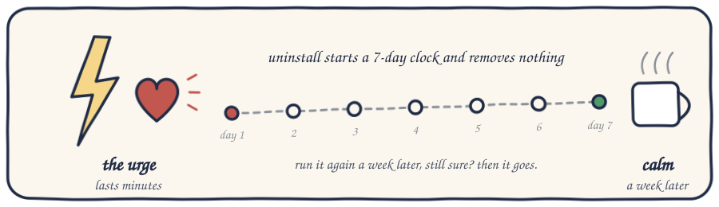

<p align="center"></p>
<p align="center">


</p>

# gamble-guard

A free, open-source gambling blocker that is built to be hard to remove. macOS, Windows, iPhone, Android.
No account, no subscription, no kernel extension, no telemetry.

It blocks **~660,000 gambling domains** system-wide — every browser, every app — and puts itself back
when removed. The list is rebuilt automatically every week from every actively maintained public
gambling blocklist, so new casinos get blocked without you doing anything.

## Install

<p align="center"></p>

**macOS** — one command, needs your password:

```sh
curl -fsSL https://raw.githubusercontent.com/prime-server/gamble-guard/main/install.sh | sudo bash
```

**Windows** — one command in an *Administrator* PowerShell:

```powershell
irm https://raw.githubusercontent.com/prime-server/gamble-guard/main/win/install.ps1 | iex
```

**iPhone / iPad** — open [`mobile/gamble-guard.mobileconfig`](mobile/gamble-guard.mobileconfig) on the
device and install it, then follow [`mobile/QUICKSTART.md`](mobile/QUICKSTART.md).

**Android** — Settings → Network → Private DNS → `family.dns.mullvad.net`. Details in
[`mobile/README.md`](mobile/README.md).

Or open this folder in [Claude Code](https://claude.com/claude-code) and say *"install this"* — the repo
ships a `CLAUDE.md` that tells the agent how, and tells it never to help you undo it.

Verify (desktop): `bet365.com` should fail to load, and resolve to `0.0.0.0` or nothing.

### Make it stick

<p align="center"></p>

| Mode | What it adds | Can the user remove it? |
|---|---|---|
| default | watchdog pair, immutable files, 7-day cooling-off on uninstall | yes, with the admin password and patience |
| `PARTNER=1 sudo ./install.sh` | a passphrase someone else holds; removal requires it | only by bypassing the installer by hand |
| `sudo ./harden.sh <user> "Name"` | partner-held admin account, you become a Standard user | **no** — there is no `sudo` to shortcut with |
| `LOCK_DAYS=90 sudo ./install.sh` | a fixed lock: uninstall refuses until the date, cooling-off or not | only with a partner passphrase |
| `VPN_BLOCK=1 sudo ./install.sh` | also blocks 16k VPN / proxy / DoH-bypass domains (Tailscale, Mullvad DNS, corporate VPNs allowlisted) | — |

Flags combine: `LOCK_DAYS=90 VPN_BLOCK=1 PARTNER=1 sudo ./install.sh`. On Windows: `install.ps1 -LockDays 90 -Partner`.
Whole-home coverage through your router, which covers phones and TVs too: [`docs/router.md`](docs/router.md).

The same tiers exist on Windows (`install.ps1 -Partner`); account hardening there is a Standard account
with the partner holding the Administrator password.

## How it works

<p align="center"></p>

Five layers. Each one covers the way the previous one gets defeated.

1. **A filtering upstream resolver.** Every network interface is pointed at Mullvad's free `family`
   DNS, which refuses to resolve gambling domains — verified against bet365, Stake, Roobet, Rainbet,
   Loto-Québec, Betway, DraftKings, Rollbit, Duelbits and bc.game, and passing GitHub, Google and the
   rest of the internet. It is the only free public resolver we found that actually blocks gambling;
   Cloudflare, OpenDNS, CleanBrowsing, AdGuard and ControlD "family" filters all let it through.
   This layer protects you even if the hosts file below is deleted, and it is what phones use.

2. **A hosts-file block.** ~660k domains pointed at `0.0.0.0` on macOS; a 26k compact brand list on
   Windows, whose DNS client stalls on large hosts files (measured: lookups hung at 344k lines).
   Hosts entries win even if someone changes the DNS server back.

3. **Browsers are forced onto the system resolver.** Chrome, Edge, Brave and Firefox have
   DNS-over-HTTPS turned *off* and locked by enterprise policy, because a browser doing its own DoH
   never consults layers 1 or 2. Most homemade blockers miss this and quietly do nothing.

4. **Two daemons that restore each other** (launchd on macOS, SYSTEM scheduled tasks on Windows) re-apply
   layers 1–3 every two minutes, restore each other if one is deleted, and refresh the blocklist weekly.
   Installed files carry the immutable flag / are locked to SYSTEM.

5. **Removal is slow by design.** `uninstall.sh` starts a 7-day cooling-off on first run and removes
   nothing. If a partner set a passphrase, it is required instead. The addiction operates on a
   timescale of minutes; this operates on a timescale of a week.

### Autoresearch

`tools/build-list.sh` merges four independently maintained gambling blocklists (The Blocklist Project,
hagezi, Sinfonietta, StevenBlack), generates TLD mirrors for brands that hop domains, refuses to publish
if a source vanishes or a major infrastructure domain sneaks in, and writes `lists/`. A GitHub Action
runs it every Monday and commits the result; every installed client pulls the new list on its next
weekly refresh. Mullvad updates its own filter server-side. Nobody has to ship a release for a new
casino to get blocked.

## Compared with Gamban and BetBlocker

|  | Gamban | BetBlocker | gamble-guard |
|---|---|---|---|
| Price | subscription | free | free, MIT, every line inspectable |
| Fixed lock period you cannot end early | no | yes | yes (`LOCK_DAYS`), partner passphrase excepted |
| Blocks VPN / proxy bypass routes | yes | optional | optional, with an allowlist so work VPNs keep working |
| Blocklist | closed | closed | ~660k domains from four public sources, rebuilt weekly, auditable |
| Still blocks if the vendor's servers die | no — a lapsed install left the browser pinned to a resolver that passed everything | — | hosts, Mullvad and browser policy are independent layers |
| Whole-home via router | no | no | yes ([`docs/router.md`](docs/router.md)) |
| Tells AI assistants not to help remove it | no | no | yes (`CLAUDE.md`, `AGENTS.md`) |
| Native phone apps | yes | yes | no — a DNS profile and Screen Time |
| Removes itself in a weak moment | needs support contact | not before the period ends | 7-day cooling-off, lock period, or partner passphrase |

Where they win: polished native apps, especially on phones. Where nobody wins: an administrator who keeps
their password can remove any of the three; only `harden.sh` changes that.

## Honest limitations

- **With the admin password, you can remove the default install.** Everything above except `harden.sh`
  is friction, not a lock. Friction is usually the whole fight — a craving lasts minutes, a 7-day
  cooling-off does not — but anyone with `sudo` can shortcut it. Do not trust any blocker that claims
  otherwise while leaving you as an admin.
- **Phones are the weakest platform.** iOS and Android cannot run daemons; an unsupervised user can
  revert the DNS setting in seconds. The real lock there is Screen Time / Family Link with a passcode
  someone else holds. [`mobile/README.md`](mobile/README.md) is blunt about this.
- **Another device, a VPN or a phone hotspot routes around all of it.** This protects the devices it is on.
- **iCloud Private Relay bypasses layers 1 and 2 in Safari.** Turn it off: System Settings → Apple
  Account → iCloud → Private Relay.
- **A dead paid blocker can be worse than nothing.** If a lapsed subscription left your browser pinned to
  a resolver that no longer filters, it also made your browser skip the hosts file. The installer clears
  that; check any such tool is actually still blocking.

If gambling is costing you more than money, the strongest version of this tool is another person.

## Updating, uninstalling, testing

```sh
sudo ./install.sh          # re-run to update (the daemons also refresh the list weekly)
sudo ./uninstall.sh        # starts the 7-day cooling-off, or completes it
sudo ./uninstall.sh --status
./tests/selftest.sh        # no root needed
```

## Credits

Blocklists: [The Blocklist Project](https://github.com/blocklistproject/Lists),
[hagezi](https://github.com/hagezi/dns-blocklists), [Sinfonietta](https://github.com/Sinfonietta/hostfiles),
[StevenBlack](https://github.com/StevenBlack/hosts). Filtering DNS: [Mullvad](https://mullvad.net/en/help/dns-over-https-and-dns-over-tls).

## Support

Canada 1-866-531-2600 · US 1-800-522-4700 · UK 0808 8020 133 · <https://www.gamblingtherapy.org>

## License

MIT — see [LICENSE](LICENSE).
